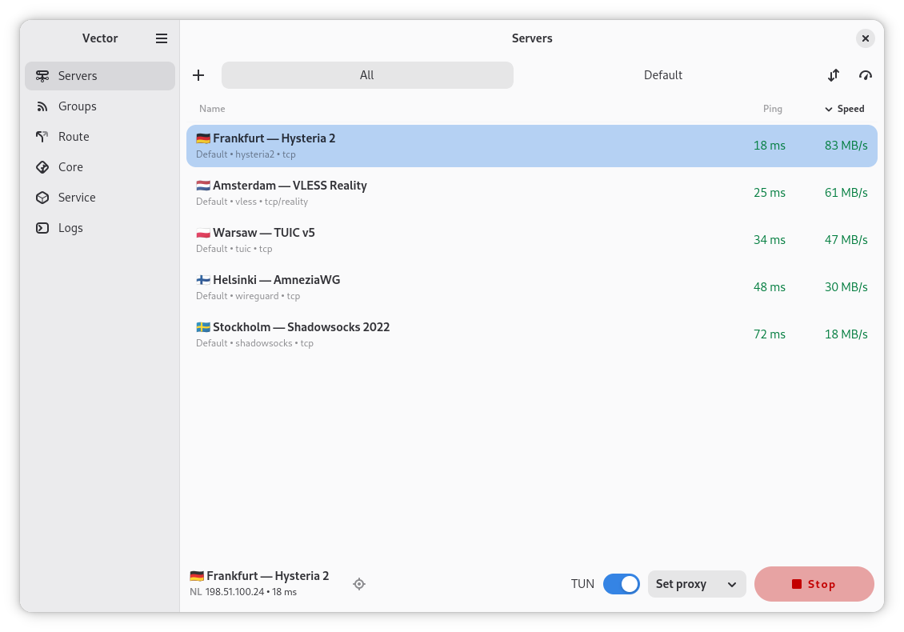
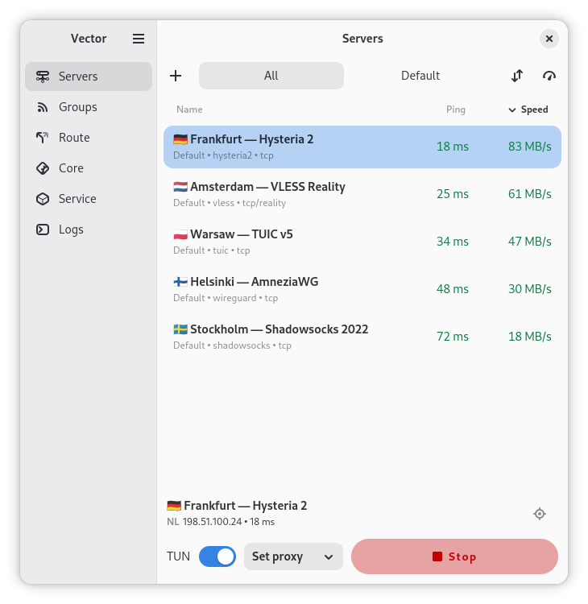
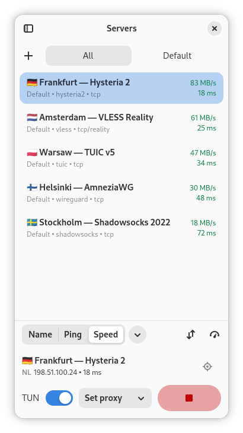

<div>
  <div align="left">
    
  </div>

  <br/> <br/> <br/> <br/> <br/> <br/>

  <h1>Vector - Proxy client for GNOME</h1>

  <p>
    Vector is a native Linux GUI client for sing-box, Xray-core and sing-box-lx,
    built with GTK4/Libadwaita and Vala,
    following the GNOME HIG.
  </p>

  <div align="left">
    
    
    
  </div>

  <br/>
</div>

## Features

- **Dual-core architecture**: runs a local **sing-box** router (DNS, routing, TUN) in front of a dedicated proxy **engine** (**sing-box**, **Xray-core**, or **sing-box-lx**); switching servers swaps only the engine while the router stays running
- **Protocols**: VLESS (Reality), VMess, Trojan, Shadowsocks, SOCKS, HTTP, WireGuard, AmneziaWG, Hysteria 2, TUIC
- **Transports**: TCP, WebSocket, gRPC, HTTPUpgrade, XHTTP, HTTP/2
- **Import & Subscriptions**: share links (`vless://`, `vmess://`, `trojan://`, `ss://`, `socks://`, `http(s)://`, `hysteria2://`/`hy2://`, `tuic://`), `awg-quick`/`.conf` files (including multi-peer), Amnezia `vpn://` links, QR codes, and auto-updating subscriptions with custom `User-Agent` and headers
- **Routing & DNS**: rule presets (Direct / Proxy / Block), custom domain and IP rules, GeoIP/GeoSite, sing-box rule-sets, and leak-free DNS routing
- **Proxy modes**:
  - **System proxy**: GSettings (`org.gnome.system.proxy`) and KDE (`kioslaverc`), no root required
  - **TUN (service)**: persistent `vector-tun.service` with one-time installation and polkit rules
  - **TUN (session)**: password prompt once per login session, password-free until logout
- **Benchmarking**: real-delay HTTP ping and download speed tests with live re-sorting
- Native GTK4/Libadwaita interface, following GNOME HIG

## Installing

Prebuilt `.rpm`, `.deb`, and portable `AppImage` packages are available on the [Releases](https://github.com/dp0sk/Vector/releases) page.

**Fedora (.rpm):**
```bash
sudo dnf install ./vector-adw-*.rpm
```

**Debian 13 / Ubuntu 25.04+ (.deb):**
```bash
sudo apt install ./vector-adw_*.deb
```

**AppImage** (uses system GTK4 and Libadwaita; minimum Debian 13, Ubuntu 25.04+, Fedora 42+):
```bash
chmod +x Vector-*.AppImage
./Vector-*.AppImage
```

> On minimal KDE installs without Libadwaita: `sudo dnf install libadwaita` / `sudo apt install libadwaita-1-0`

## Dependencies

- GTK4 >= 4.18
- libadwaita >= 1.7
- GLib >= 2.74
- libsoup-3.0
- json-glib-1.0
- libqrencode
- valac >= 0.56
- meson >= 0.62, ninja, python3
- Runtime (for TUN mode): `systemd`, `polkit`

**Fedora:**
```bash
sudo dnf install vala meson ninja-build gcc gtk4-devel libadwaita-devel \
    libsoup3-devel json-glib-devel qrencode-devel python3
```

**Debian 13 / Ubuntu 25.04+:**
```bash
sudo apt install valac meson ninja-build gcc pkg-config \
    libgtk-4-dev libadwaita-1-dev libsoup-3.0-dev libjson-glib-dev libqrencode-dev python3
```

## Building packages & AppImage

Clone the repository:

```bash
git clone https://github.com/dp0sk/Vector.git
cd Vector
```

Build packages into `build/packages/` (containerized via Podman/Docker):

```bash
./build.sh --deb                  # Debian 13 container -> runs on Debian 13, Ubuntu 25.04+
FEDORA_RELEASE=44 ./build.sh --rpm # Fedora container
./build.sh --appimage             # Portable AppImage (add --no-container for host build)
./build.sh --all                  # Builds binary, AppImage, .deb and .rpm
```

## Building from source (meson)

Clone the repository:

```bash
git clone https://github.com/dp0sk/Vector.git
cd Vector
```

Set up the build directory (fetches pinned `xray`, `sing-box`, and `sing-box-lx` cores; pass `-Dfetch_cores=false` to skip):

```bash
meson setup build
```

Compile:

```bash
meson compile -C build
```

Run tests:

```bash
meson test -C build
```

Install (requires root or sudo):

```bash
sudo meson install -C build
```

Run:

```bash
vector-adw
```

## Data & config paths

| Path | Contents |
|---|---|
| `~/.config/vector/` | `settings.json`, `nodes.json`, `subs.json`, `routing.json`; generated `router.json`, `proxy-router.json`, `engine.json` (mode `0700` / `0600`). |
| `~/.local/share/vector/` | Geo files, `.srs` rule-sets, core binaries (`bin/`), logs. |
| `/usr/local/libexec/vector/` | Installed TUN router binary (`vector-router`). |

## Known limitations & Hacking

- **Amnezia `vpn://` links**: only WireGuard and AmneziaWG containers are extracted (OpenVPN/Cloak are not bundled).
- The router downloads remote rule-sets on its first start (can take up to 90 seconds).
- Core versions are pinned and SHA-256 verified in `fetch_cores.py`.
- Full backlog is in [TODO.md](TODO.md). Architecture notes and development workflows are in [SLOPMACHINE.md](SLOPMACHINE.md).

## Acknowledgments

- [GNOME](https://www.gnome.org/) and [Libadwaita](https://gitlab.gnome.org/GNOME/libadwaita) — design patterns, Human Interface Guidelines, and platform libraries.
- [GNOME Icon Library](https://gitlab.gnome.org/World/design/icon-library) — symbolic icons.
- [Project V / V2Ray](https://v2ray.com/) — application icon concept and design inspiration.
- [v2rayN](https://github.com/2dust/v2rayN) — inspiration for client architecture, benchmark testing, and subscription workflows.
- [sing-box](https://github.com/SagerNet/sing-box), [Xray-core](https://github.com/XTLS/Xray-core), and [sing-box-lx](https://github.com/Leadaxe/sing-box-lx) — the core proxy engines powering Vector.
- [Happ](https://www.happ.su/) and [INCY](https://github.com/INCY-DEV) — fuck you for all your ugly proprietary bullshit.

## License

GPL-3.0-only — see [LICENSE](LICENSE).
